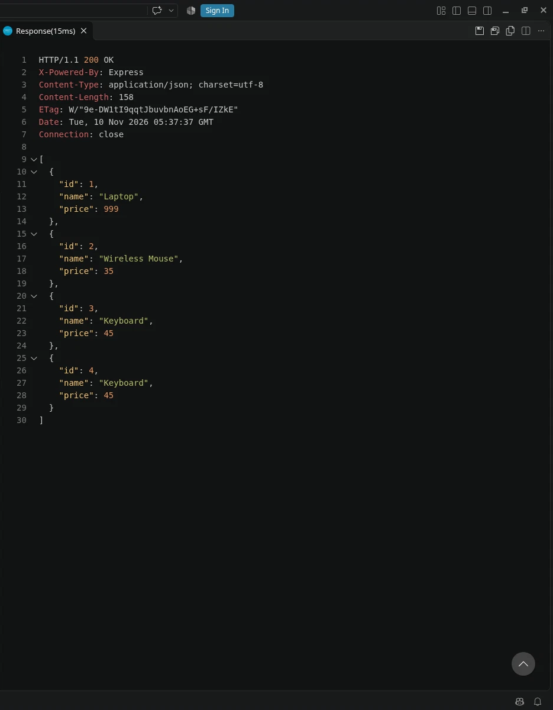
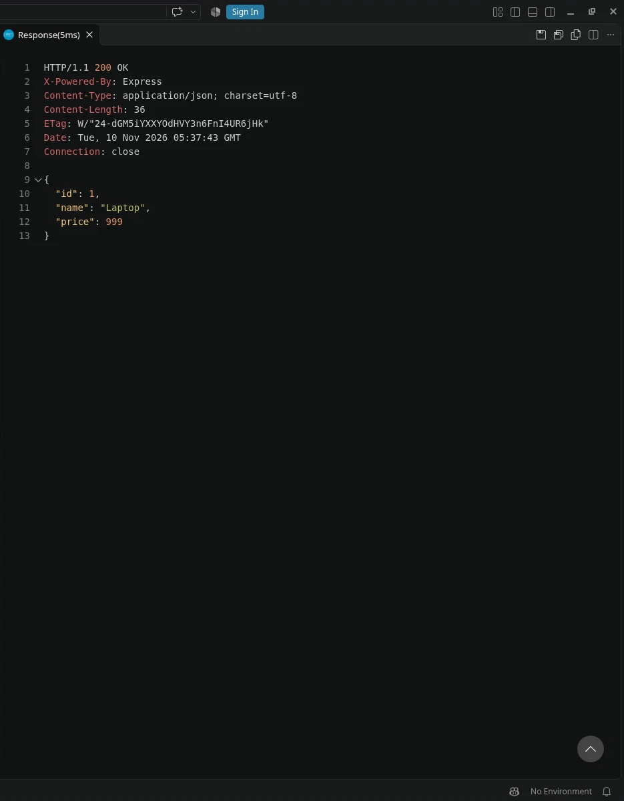
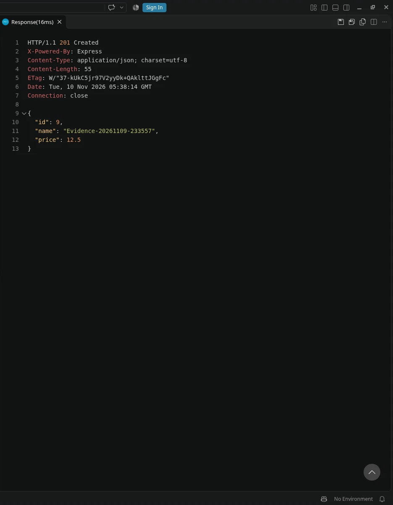
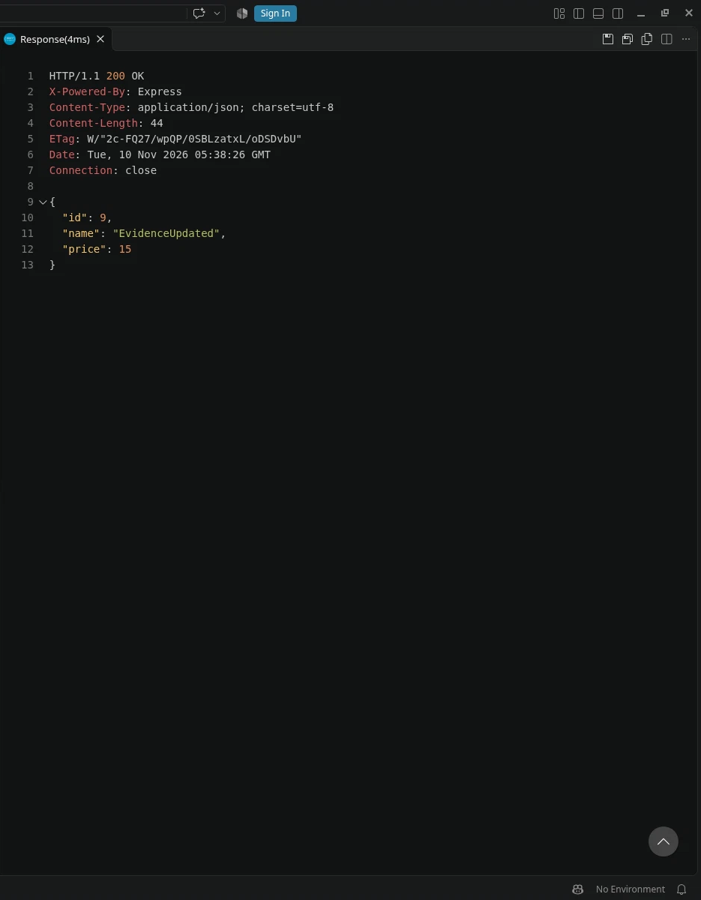
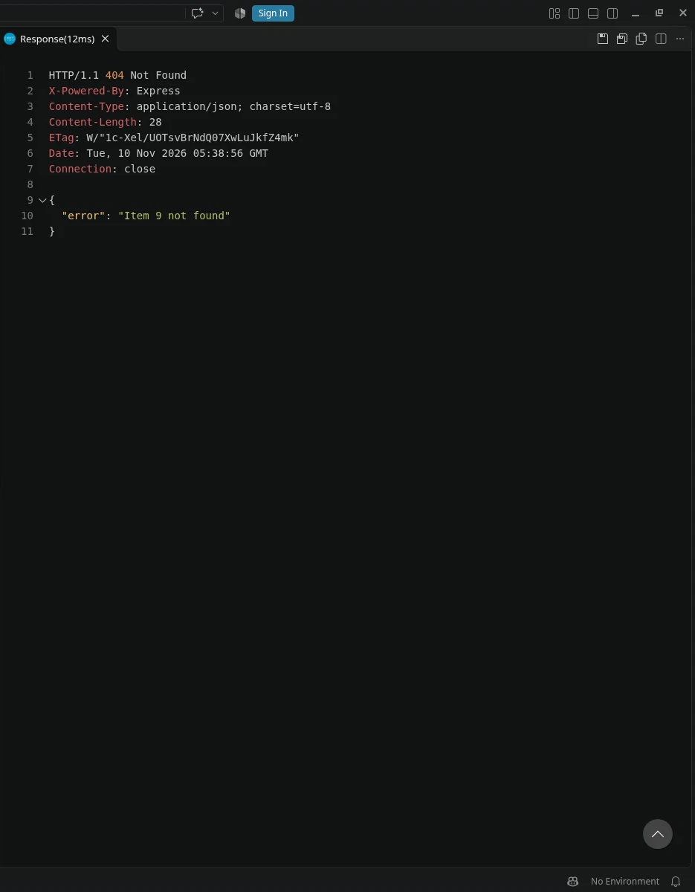
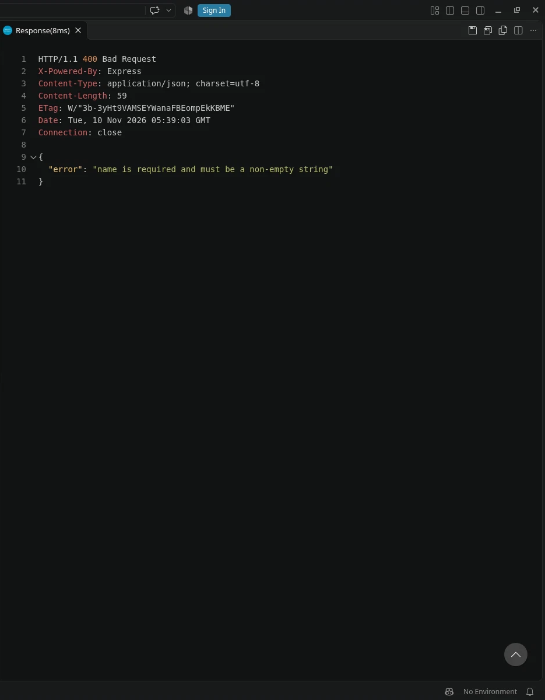

# Assignment 8

   A small Express API that stores items in an in-memory array.
   Data resets when the server restarts.

   ## Setup
       npm install
       npm start
   Server runs on http://localhost:3000

# Testing while server is active run these commands:

$ curl -i http://localhost:3000/api/items

$ curl -i http://localhost:3000/api/items/1

$ curl -i http://localhost:3000/api/items/99

$ curl -i -X POST http://localhost:3000/api/items -H "Content-Type: application/json" -d {"name":"Keyboard","price":75}

$ curl -i -X PUT http://localhost:3000/api/items/1 -H "Content-Type: application/json" -d {"price":899}

$ curl -i -X DELETE http://localhost:3000/api/items/2

$ curl -i -X DELETE http://localhost:3000/api/items/2

# Assignment 9: PostgreSQL

Items are stored in PostgreSQL.

Tested with VS Code REST Client.

| Request | Result |
| --- | --- |
| GET /api/items | 200 |
| GET /api/items/1 | 200 |
| POST /api/items | 201 |
| PUT /api/items/9 | 200 |
| DELETE /api/items/9 | 200 |
| GET /api/items/9 (after delete) | 404 |
| POST /api/items (missing name) | 400 |
| GET /api/items/abc | 400 |

## VS Code REST Client screenshots

GET /api/items 200

GET /api/items/1 200

POST /api/items 201

PUT /api/items/9 200

DELETE /api/items/9 200

GET /api/items/9 (after delete) 404

POST /api/items (missing name) 400

GET /api/items/abc 400

